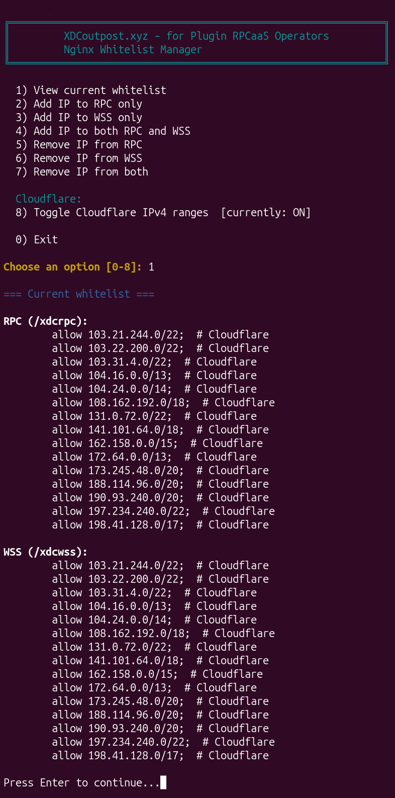

<p align="center">
  
</p>

# Plugin-XDC-Secure-RPC-WSS

Simple installer for Plugin RPCaaS operators.  

It sets up a secure XDC node (Mainnet or Apothem Testnet) and gives you private RPC and WebSocket endpoints that only allow the IP addresses you choose. The installer can optionally download the official chain snapshot and automatically integrate it, so the node reaches a usable state much faster than syncing from genesis.

**What you will get:**
- RPC: `https://yourdomain.com/xdcrpc`
- WSS: `wss://yourdomain.com/xdcwss`

---

##  What you need before you start

- An Ubuntu server (24.04 or 26.04)
- Root access (you can log in as `root`)
- A domain name (example: `node.example.com`)
- The domain’s **A record must already point** to your server’s public IP address
- Ports 22 (SSH), 80, 443, and 30303 open (most VPS providers have these open by default)

Recommended server size for a full node:
- 6+ CPU cores
- 32 GB RAM
- 2+ TB SSD (1.5 TB ok if syncing chain from genesis)

---

##  Step-by-step installation

### Step 1 – Log in as root

SSH into your server as the `root` user.

```bash
ssh root@YOUR_SERVER_IP
```

### Step 2 – Download the installer and create a normal user

Copy and paste this entire line into your terminal and press Enter:

```bash
apt update -y && apt upgrade -y && apt install -y git nano curl && apt autoremove -y && git clone https://github.com/s4njk4n/Plugin-XDC-Secure-RPC-WSS.git && cd Plugin-XDC-Secure-RPC-WSS && chmod +x *.sh && bash ./create_nonroot_user.sh
```

The script will ask you for:
- A username
- A password

It will then:
- Create that user
- Give the user sudo rights
- Move the installer files into the user’s home folder
- Show you the exact commands to run next

### Step 3 – Log out and log back in as the new user

Type this and press Enter:

```bash
exit
```

Now SSH back in using the new username (replace `YOUR_USERNAME` and `YOUR_SERVER_IP`):

```bash
ssh YOUR_USERNAME@YOUR_SERVER_IP
```

### Step 4 – Run the main installer

Once you are logged in as the new user, copy and paste this entire line:

```bash
cd ~/Plugin-XDC-Secure-RPC-WSS && screen -L -S xdc-install sudo ./install_xdc_rpc_wss.sh; status=$?; echo; echo '=== Screen log ==='; cat screenlog.0 2>/dev/null || true; if [[ $status -ne 0 ]]; then echo; echo '=== Summary / error note ==='; cat xdc-install-summary.txt 2>/dev/null || true; fi
```

The installer will ask you a series of questions like this:


##### Installer Prompts
- **Network**: `mainnet` or `testnet` (default: `mainnet`)
- **Node Type**:
  - `full` — pruned node (lower disk usage; recommended for most RPC use)
  - `archive` — keeps full history (needs more disk space)
- **Enabled APIs**:
  - Default: `eth,net,web3`
  - Archive nodes also enable `debug,trace` by default
  - Optional extras: `db,txpool,XDPoS`
  - Avoid `admin` and `personal` unless you specifically need them and understand the risks
- **Node Name**: any name you like (shown on network stats; default provided)
- **Contact Email**
- **Domain Name**: must already have its A record pointing to this server
- **Let’s Encrypt Email**: usually the same as the contact email
- **SSH Port**: usually just press Enter for `22`
- **Chain Snapshot**:
  - Choosing `y` downloads the official snapshot (much faster than syncing from genesis).
  - You then choose the download method:
    - **[1] Resumable** – downloads the `.tar.lz4` file (can resume if interrupted; uses more temporary disk space).
    - **[2] Stream** – streams, decompresses and extracts in one step (uses less disk space; not resumable).
  - The script checks free disk space before proceeding and will stop if there is not enough.
  - The correct snapshot is selected automatically based on network and node type.
- **Whitelist IPs**:
  - Option to add the Plugin RPCaaS server IP
  - Option to add an IP for testing the endpoints
  - Then a loop to add any additional IPs

**Important tips while the installer is running:**
- The installation can take a long time (especially if downloading the snapshot).
- If you need to disconnect, press `Ctrl+A` then `D` to detach from screen. You can reconnect later with:

```bash
screen -r xdc-install
```

When it finishes it will show your final RPC and WSS addresses and save a summary file.

---

##  After installation

### Review the installation output

First check the end of the install log (most useful for context, warnings, and troubleshooting):

```bash
cat ~/Plugin-XDC-Secure-RPC-WSS/screenlog.0
```

Then look at the short summary (endpoints, config, and test commands):

```bash
cat ~/Plugin-XDC-Secure-RPC-WSS/xdc-install-summary.txt
```

If anything looks wrong, both files are in the same directory and are the first things to inspect.

### Manage who is allowed to connect

To add or remove IP addresses at any stage:

```bash
cd ~/Plugin-XDC-Secure-RPC-WSS && sudo ./manage_whitelist.sh
```

The whitelist manager looks like this:


Use the menu to view, add, or remove IPs. Changes take effect immediately.

### Test your RPC endpoint

**Important:** This must be run from an IP address that was whitelisted during installation (or added later with `manage_whitelist.sh`). Requests from other IPs will receive a 403 Forbidden response.

Replace `yourdomain.com` with your real domain:

```bash
curl -H "Content-Type: application/json" \
  --data '{"jsonrpc":"2.0","method":"net_version","params":[],"id":1}' \
  https://yourdomain.com/xdcrpc
```

Mainnet should return `"result":"50"`.  
Testnet should return `"result":"51"`.

### Test your WSS endpoint

From a whitelisted IP, you can test the WebSocket endpoint with `wscat`:

```bash
# Install once if needed
sudo npm install -g wscat

# Connect
wscat -c wss://yourdomain.com/xdcwss

# Once connected, paste this and press Enter:
{"jsonrpc":"2.0","method":"net_version","params":[],"id":1}
```

You should see a response with `"result":"50"` (mainnet) or `"result":"51"` (testnet).  
Press `Ctrl+C` or type `exit` to quit.

### Useful commands

Check if the node is running:

```bash
sudo docker compose -f ~/XinFin-Node/mainnet/docker-compose.yml ps
or
sudo docker compose -f ~/XinFin-Node/testnet/docker-compose.yml ps
```

Watch the node logs:

```bash
sudo docker compose -f ~/XinFin-Node/mainnet/docker-compose.yml logs -f
or
sudo docker compose -f ~/XinFin-Node/testnet/docker-compose.yml logs -f
```

---

##  Scripts in this repository

| Script | What it does |
|--------|--------------|
| `create_nonroot_user.sh` | Creates a normal sudo user and moves the files into their home folder. |
| `install_xdc_rpc_wss.sh` | Installs and secures the XDC node with RPC/WSS endpoints. |
| `manage_whitelist.sh` | Lets you add or remove allowed IP addresses after installation. |
| `backup_xdc_configs.sh` | Creates timestamped backups of the current Nginx config, `.env`, and `docker-compose.yml` in the user’s home directory. Useful before upgrades or changes. |

---

##  Configuration Backups

During installation the script automatically saves timestamped copies of the three main configuration files into a dedicated directory in your home folder:

`~/XDC-Backups/`

- `XDCnode-Nginx.config.backup-xdc-node_YYYY-MM-DD_HH-MM-SS`
- `XDCnode-env.backup-.env_YYYY-MM-DD_HH-MM-SS`
- `XDCnode-docker.settings.backup-docker-compose.yml_YYYY-MM-DD_HH-MM-SS`

You can also create a fresh set of backups at any time (for example before an upgrade or before pulling a new version of the repository) with the standalone script:

```bash
cd ~/Plugin-XDC-Secure-RPC-WSS && sudo ./backup_xdc_configs.sh
```

The script detects whether you have a mainnet and/or testnet node and backs up whichever configs exist.

---

##  Security Notes

- The node’s RPC and WebSocket ports only listen on localhost.
- Nginx handles HTTPS and only allows the IP addresses you whitelist.
- The firewall only allows SSH, P2P (port 30303), and web ports 80/443.
- You should only whitelist the Plugin RPCaaS IP and any IPs you personally need for testing.

---

##  Using Cloudflare with your RPC/WSS

_Note: If wanting to use Cloudflare, make sure your A record is set to "DNS only" (grey cloud) when installing the node in the steps above if your DNS is already at Cloudflare. The setup below regarding the "Proxied" (orange cloud) Proxy status is only to be done AFTER you've already completed the node setup steps above._

Cloudflare is a free reverse-proxy and security service that sits in front of your server. When you turn it on for your domain, visitors connect to Cloudflare’s network instead of directly to your VPS. Cloudflare then forwards only the allowed traffic to your origin.

### Benefits for an RPC/WSS endpoint

- Hides your server’s real IP address
- Provides basic DDoS protection and rate limiting
- Gives you a free web application firewall (WAF) and bot protection options
- Lets you add extra access rules later (Cloudflare Access, country blocks, etc.) without changing the node
- Works with the Let’s Encrypt certificate the installer already sets up

### 1. Create a Cloudflare account and add your domain

1. Go to [https://dash.cloudflare.com/sign-up](https://dash.cloudflare.com/sign-up) and create a free account.
2. Click **Add a site** and enter the domain you used during installation (e.g. `yourdomain.com`).
3. Choose the **Free** plan.
4. Cloudflare will show you two nameservers. Log in to your domain registrar and replace the existing nameservers with the ones Cloudflare gives you.
5. Wait for the nameservers to update (usually a few minutes to a couple of hours). Cloudflare will email you when the domain is active.

### 2. Configure DNS and SSL in Cloudflare

1. In the Cloudflare dashboard go to **DNS** → **Records**.
2. Make sure there is an **A** record pointing to your VPS public IP address.
3. Click the cloud icon so it turns **orange** (proxied). Grey-cloud (DNS-only) mode will not hide your IP or provide the protection.
4. Go to **SSL/TLS** → **Overview** and set the encryption mode to **Full (strict)**.  
   This matches the Let’s Encrypt certificate the installer created on the VPS.
5. (Optional but recommended) Under **SSL/TLS** → **Edge Certificates**, turn on **Always Use HTTPS** and **Automatic HTTPS Rewrites**.

### 3. Allow only specific IPs through Cloudflare

By default Cloudflare proxies traffic from anyone. To restrict the RPC/WSS so that only your chosen IP addresses can reach the origin, create a WAF custom rule.

1. In the Cloudflare dashboard go to **Security** → **WAF** → **Custom rules**.
2. Click **Create rule**.
3. Give it a name such as `Allow only whitelisted IPs on abc.defg.com`.
4. In the expression editor use something like this (replace the subdomain name and example IPs with your real ones):

```
(http.host eq "abc.defg.com") and (not ip.src in {3.4.5.6 2.3.4.5})
```

5. Set the action to **Block**.
6. Click **Deploy**.

Only the IP addresses you listed will be able to reach your RPC and WSS endpoints. Everyone else receives a Cloudflare block page. You can edit the rule later to add or remove IPs.

(If you prefer the older interface, the same thing can be done under **Security** → **WAF** → **Tools** → **IP Access Rules** by adding Allow rules for your IPs and a Block rule for `0.0.0.0/0`.)

### 4. Allow Cloudflare’s IP ranges on the VPS

Because traffic now arrives from Cloudflare’s servers (not from the original visitor’s IP), Nginx must be told to accept Cloudflare’s IP ranges. The whitelist manager has a one-click option for this.

On the VPS run:

```bash
cd ~/Plugin-XDC-Secure-RPC-WSS && sudo ./manage_whitelist.sh
```

Choose option **8) Toggle Cloudflare IPv4 ranges**.  
When it shows **[currently: OFF]**, selecting it will fetch the latest official Cloudflare IPv4 list and add every range to both the RPC and WSS locations (labelled `# Cloudflare`). Selecting it again removes them.

After the toggle finishes, Nginx is automatically reloaded. You can confirm the entries with option **1) View current whitelist**.



### 5. Test

From one of the IP addresses you allowed in the Cloudflare WAF rule:

```bash
curl -H "Content-Type: application/json" \
  --data '{"jsonrpc":"2.0","method":"net_version","params":[],"id":1}' \
  https://yourdomain.com/xdcrpc
```

Mainnet should return `"result":"50"`.  
Testnet should return `"result":"51"`.

Requests from any other IP should be blocked by Cloudflare before they ever reach your VPS.

### Notes

- Only the Cloudflare IP ranges need to be whitelisted on the VPS. Individual visitor IPs no longer appear at Nginx.
- The real access control is now done in Cloudflare’s WAF custom rule (step 3).
- You can still add or remove your own extra IPs with the normal menu options on the VPS if you want direct (non-proxied) access as well.
- If you later turn Cloudflare off (grey cloud), remember to toggle the Cloudflare ranges **OFF** again so those large ranges are not left open unnecessarily.

---

##  Common problems

| Problem | What to do |
|---------|------------|
| Let’s Encrypt fails | Make sure your domain’s A record points to this server and ports 80 & 443 are open. |
| You get 403 Forbidden | Your IP is not on the whitelist. Run `sudo ./manage_whitelist.sh` and add it. |
| Node seems stuck | Check logs with the `docker compose logs -f` command above. |
| Installer stopped with an error | Look at `xdc-install-summary.txt` and `screenlog.0` in the home folder. |
| Insufficient disk space during snapshot | Choose the stream method (uses less temporary space) or free up disk. The script reports required vs available space before starting the download. |

---

## License

MIT License — see the [LICENSE](LICENSE) file.

---

## Disclaimer

This is provided as-is. Please read the scripts before running them. You are responsible for your server and node.

---

**Author:** [s4njk4n](https://github.com/s4njk4n)  
More info: [XDCoutpost.xyz](https://xdcoutpost.xyz)

Special thanks to inv4fee2020 for the earlier XDC node installer work and for the color scheme that inspired this recreation. This project is an independent rewrite and does not reuse the original scripts.

