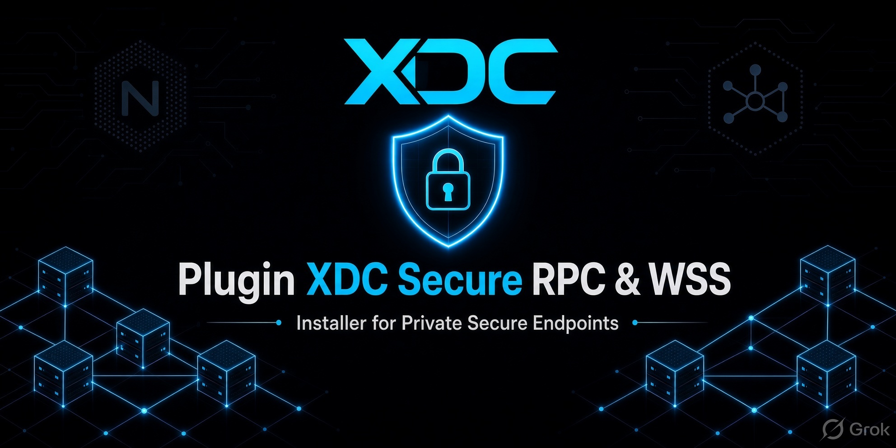
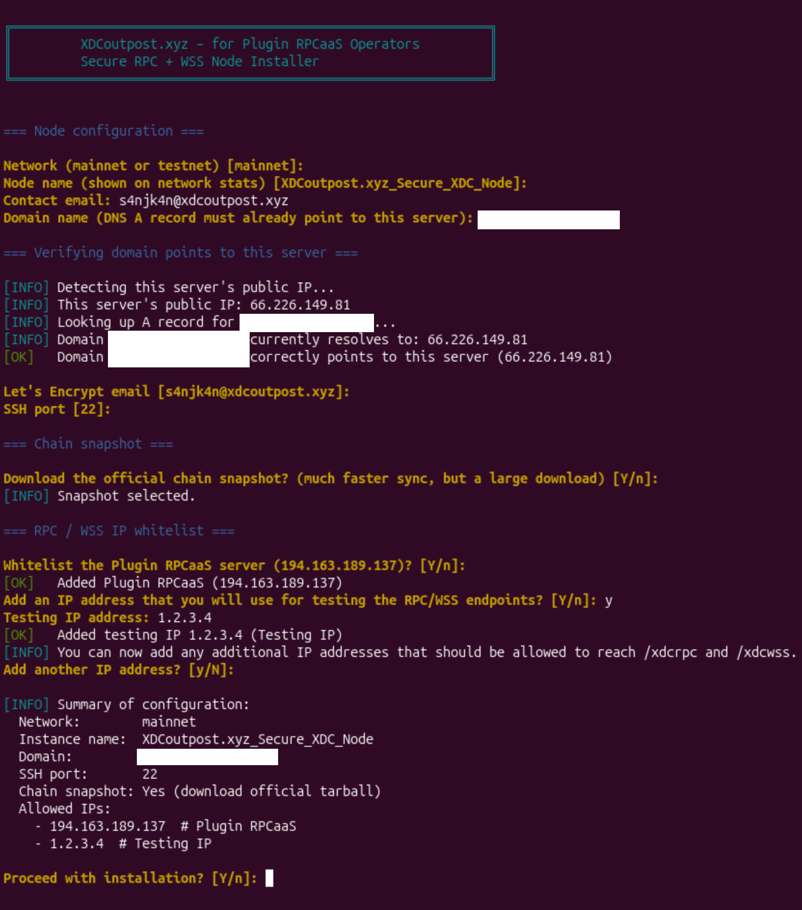
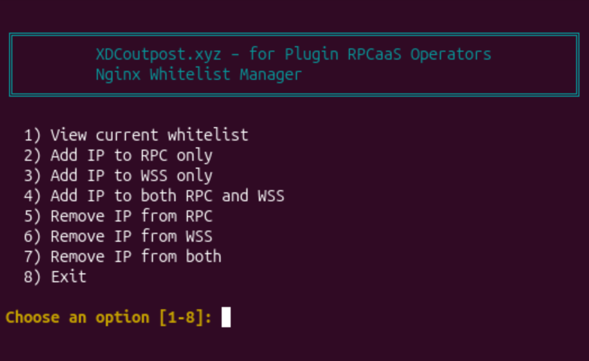

<p align="center">
  
</p>

# Plugin-XDC-Secure-RPC-WSS

Simple installer for Plugin RPCaaS operators.  
It sets up a secure XDC node (Mainnet or Apothem Testnet) and gives you private RPC and WebSocket endpoints that only allow the IP addresses you choose.

**What you will get:**
- RPC: `https://yourdomain.com/xdcrpc`
- WSS: `wss://yourdomain.com/xdcwss`

---

## What you need before you start

- An Ubuntu server (24.04 or 26.04)
- Root access (you can log in as `root`)
- A domain name (example: `node.example.com`)
- The domain’s **A record must already point** to your server’s public IP address
- Ports 22, 80, 443, and 30303 open (most VPS providers have these open by default)

Recommended server size for a full node:
- 6+ CPU cores
- 32 GB RAM
- 2+ TB SSD (1.5 TB ok if syncing chain from genesis)

---

## Step-by-step installation

### Step 1 – Log in as root

SSH into your server as the `root` user.

```bash
ssh root@YOUR_SERVER_IP
```

### Step 2 – Download the installer and create a normal user

Copy and paste this entire line into your terminal and press Enter:

```bash
apt update -y && apt upgrade -y && apt install -y git nano curl && apt autoremove -y && git clone https://github.com/s4njk4n/Plugin-XDC-Secure-RPC-WSS.git && cd Plugin-XDC-Secure-RPC-WSS && chmod +x *.sh && bash ./create_nonroot_user.sh
```

The script will ask you for:
- A username
- A password

It will then:
- Create that user
- Give the user sudo rights
- Move the installer files into the user’s home folder
- Show you the exact commands to run next

### Step 3 – Log out and log back in as the new user

Type this and press Enter:

```bash
exit
```

Now SSH back in using the new username (replace `YOUR_USERNAME` and `YOUR_SERVER_IP`):

```bash
ssh YOUR_USERNAME@YOUR_SERVER_IP
```

### Step 4 – Run the main installer (inside a screen session)

Once you are logged in as the new user, copy and paste this entire line:

```bash
cd ~/Plugin-XDC-Secure-RPC-WSS && screen -L -S xdc-install sudo ./install_xdc_rpc_wss.sh; status=$?; echo; echo '=== Screen log ==='; cat screenlog.0 2>/dev/null || true; if [[ $status -ne 0 ]]; then echo; echo '=== Summary / error note ==='; cat xdc-install-summary.txt 2>/dev/null || true; fi
```

The installer will ask you a series of questions like this:



Answer the installers questions carefully:

- Network: type `mainnet` or `testnet`
- Node name: any name you like (it shows on network stats)
- Contact email: your email
- Domain name: the domain that already points to this server
- Let’s Encrypt email: usually the same email
- SSH port: usually just press Enter for `22`
- Download snapshot: recommended to choose `y` (much faster)
- Whitelist IPs: it will offer to add the Plugin RPCaaS IP. Add any other IPs you want to allow.

**Important tips while the installer is running:**
- The installation can take a long time (especially if downloading the snapshot).
- If you need to disconnect, press `Ctrl+A` then `D` to detach from screen. You can reconnect later with:

```bash
screen -r xdc-install
```

When it finishes it will show your final RPC and WSS addresses and save a summary file.

---

## After installation

### Check the summary

```bash
cat ~/Plugin-XDC-Secure-RPC-WSS/xdc-install-summary.txt
```

### Manage who is allowed to connect

To add or remove IP addresses at any stage:

```bash
cd ~/Plugin-XDC-Secure-RPC-WSS
sudo ./manage_whitelist.sh
```

The whitelist manager looks like this:



Use the menu to view, add, or remove IPs. Changes take effect immediately.

### Test your RPC endpoint

**Important:** This must be run from an IP address that was whitelisted during installation (or added later with `manage_whitelist.sh`). Requests from other IPs will receive a 403 Forbidden response.

Replace `yourdomain.com` with your real domain:

```bash
curl -H "Content-Type: application/json" \
  --data '{"jsonrpc":"2.0","method":"net_version","params":[],"id":1}' \
  https://yourdomain.com/xdcrpc
```

Mainnet should return `"result":"50"`.  
Testnet should return `"result":"51"`.

### Test your WSS endpoint

From a whitelisted IP, you can test the WebSocket endpoint with `wscat`:

```bash
# Install once if needed
sudo npm install -g wscat

# Connect
wscat -c wss://yourdomain.com/xdcwss

# Once connected, paste this and press Enter:
{"jsonrpc":"2.0","method":"net_version","params":[],"id":1}
```

You should see a response with `"result":"50"` (mainnet) or `"result":"51"` (testnet).  
Press `Ctrl+C` or type `exit` to quit.

### Useful commands

Check if the node is running:

```bash
sudo docker compose -f ~/XinFin-Node/docker-compose.yml ps
```

Watch the node logs:

```bash
sudo docker compose -f ~/XinFin-Node/docker-compose.yml logs -f
```

---

## Scripts in this repository

| Script | What it does |
|--------|--------------|
| `create_nonroot_user.sh` | Creates a normal sudo user and moves the files into their home folder. |
| `install_xdc_rpc_wss.sh` | Installs and secures the XDC node with RPC/WSS endpoints. |
| `manage_whitelist.sh` | Lets you add or remove allowed IP addresses after installation. |

---

## Security notes

- The node’s RPC and WebSocket ports only listen on localhost.
- Nginx handles HTTPS and only allows the IP addresses you whitelist.
- The firewall only allows SSH, P2P (port 30303), and web ports 80/443.
- You should only whitelist the Plugin RPCaaS IP and any IPs you personally need for testing.

---

## Common problems

| Problem | What to do |
|---------|------------|
| Let’s Encrypt fails | Make sure your domain’s A record points to this server and ports 80 & 443 are open. |
| You get 403 Forbidden | Your IP is not on the whitelist. Run `sudo ./manage_whitelist.sh` and add it. |
| Node seems stuck | Check logs with the `docker compose logs -f` command above. |
| Installer stopped with an error | Look at `xdc-install-summary.txt` and `screenlog.0` in the home folder. |

---

## License

MIT License — see the [LICENSE](LICENSE) file.

---

## Disclaimer

This is provided as-is. Please read the scripts before running them. You are responsible for your server and node.

---

**Author:** [s4njk4n](https://github.com/s4njk4n)  
More info: [XDCoutpost.xyz](https://xdcoutpost.xyz)

Special thanks to inv4fee2020 for the earlier XDC node installer work and for the color scheme that inspired this recreation. This project is an independent rewrite and does not reuse the original scripts.

